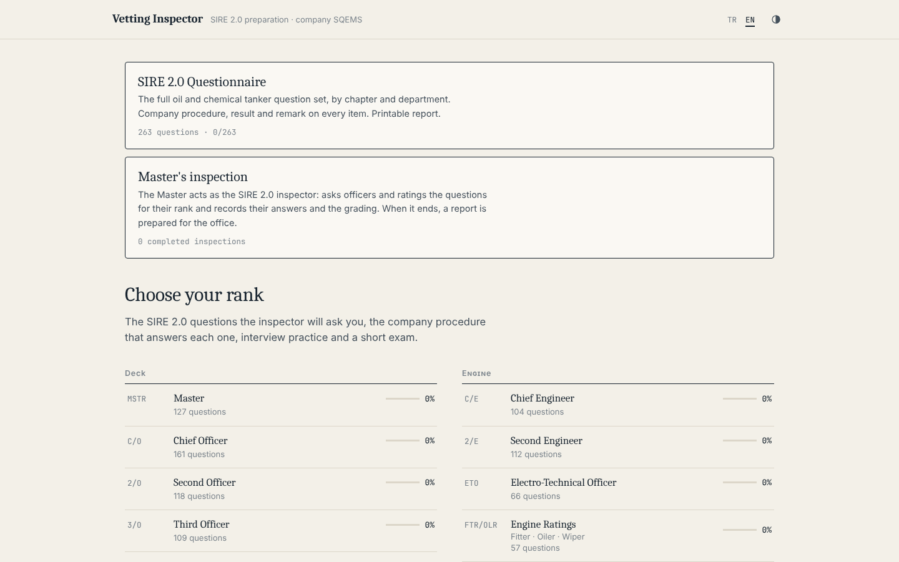
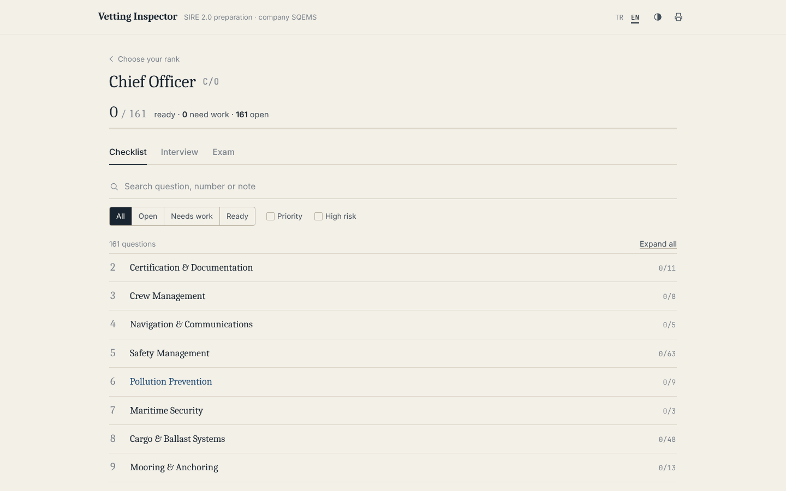
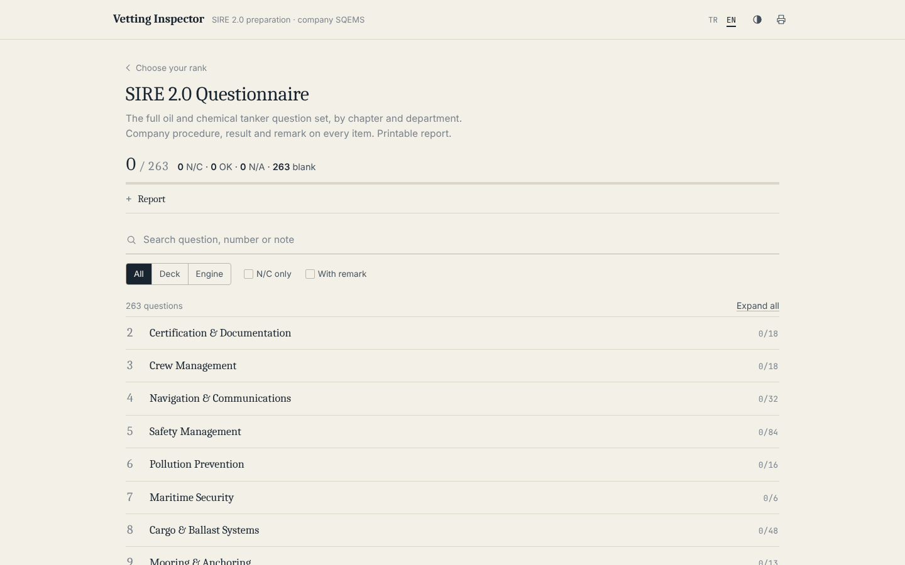

# Vetting Inspector

SIRE 2.0 preparation by rank, with answers from the company's SQEMS procedures.
No installation and no internet needed: open `index.html` in a browser.

SIRE 2.0 vetting inspection preparation for oil and chemical tanker crews: the full questionnaire by rank (Master, Chief Officer, Chief Engineer…), the company procedure for every question, interview practice, an exam and a printable report. Offline web app, Turkish and English interface.

## Contents
- **263 official SIRE 2.0 questions** (oil/chemical tanker; gas, LNG fuel, DP/shuttle, OBO, polar and photograph questions excluded).
- For every question: the official question text (English), the **company procedure** (with manual book and section, e.g. `B2 §2.2.3.1`), what to show / evidence / common findings, and the rating pocket guide and inspector notes where available.
- 258 questions have a company procedure, written from the full manual set (B1–B7). The 5 questions with no counterpart in the manuals (5.4.9, 5.9.2, 5.10.4, 6.4.2, 9.6.1) are marked as such.
- **152 exam questions**; 82 come directly from the company manuals (form numbers, intervals, limits), including B5 engine, B7 training, audit and LSA topics.

## SIRE 2.0 Questionnaire (main menu)
- The complete oil and chemical tanker question list (263 questions), by chapter, with a **Deck / Engine** filter.
- Each item highlights the company procedure reference; expanding it shows the official question text and the procedure itself.
- **Manual references are clickable:** clicking the section number in a reference such as `B1 5.5.1` opens that procedure's pages as a separate PDF (to show the inspector). Hovering over the link shows the page number in the manual.
- Each item has a result (**OK / N/C / N/A**) and a **remark** field.
- **Report:** A4 print/PDF or Excel (CSV, `;`-separated) with ship, port, date and prepared-by details. All questions, or only those with N/C and remarks; the selected department filter also applies to the report.

## Master's inspection (main menu)
- The Master acts as the SIRE 2.0 inspector: enters ship, port, date, inspector and office e-mail, and selects the officers and ratings to interview (rank + name).
- Question scope: priority + high risk, all questions for the rank, or a random 10. Chapter 2 (Certification and Documentation) is out of scope.
- For each question the official question text (the pocket guide question for ratings) and, if wanted, the expected answer (company procedure); the answer given, the SIRE 2.0 human response grading (**Not as expected / Largely as expected / As expected / Exceeds expectation / N/A**), the observation type (Human / Process / Hardware) and the inspector's note are recorded.
- At the end, an **office report**: summary, a table per person, observations and all questions and answers. A4 print/PDF, Excel (CSV) and a summary e-mail draft to the office address (PDF/CSV attached). Completed inspections are kept on the device.
- Code: `js/captain.js`.

## Ranks
Deck: Master · Chief Officer · Second Officer · Third Officer · Deck Ratings
Engine: Chief Engineer · Second Engineer · ETO · Engine Ratings

## Sources (`tools/source/`)
| File | Use |
|---|---|
| `manuals/full/B1.pdf` … `B7.pdf` (+ `.txt` texts) | **Full set** (printed 05.10.2026): B1 SMM, B2 HSSEQ, B3 Bridge & Deck, B4 Cargo, B5 Engine, B6 Emergency, B7 Training. All references were checked against this set. |
| `manuals/*.pdf` (old partial copies) | Archive only; `B3_Bridge_Deck.txt` is the old NotebookLM text |
| `manuals/pages/` | A cut PDF of every referenced section (`B1_5.5.1.pdf` …), produced by `tools/build_manual_pages.py` |
| `manuals/MSMP_LMP_ADA.pdf` | M/T ADA Mooring System Management Plan and Line Management Plan (chapter 9) |
| `<company>_SIRE_2_0_Tum_Sorular.xlsx` | Official question texts, Core/Rotational information, inspector notes |
| `<company>_SIRE_2_0_Secilmis_Sorular_Zabitler.xlsx` | "Priority" flag |
| `<company>_SIRE_2_0_Rating_Mulakat_Sorulari.docx` | Rating pocket guide (21 items) |

**The manual set is complete.** B5 (engine: UMS, emergency generator, switchboard isolation, oil analysis, bunkering, fuel changeover) and B7 (training matrix: BRM, ship handling, CCH/OCH, ERM) filled in the chapter 3 and 10 questions. The 5 questions with no counterpart: emergency lighting test (5.4.9), spare parts for a single hose crane (5.9.2), personnel transfer basket (5.10.4), oily water on the forecastle (6.4.2), steam collection at the buoy (9.6.1).

**Why the Excel answers weren't used:** 304 of the 344 answers are boilerplate sentences; the rest cite forms (SMS-B5-F06 etc.) and section numbers that don't exist in the manuals. Company forms have 4-digit numbers (3602-A, 3703, 3501…).

## Updating
- If the Excel/Word files change: `python3 tools/import_company.py` (needs `pip install openpyxl python-docx`) → regenerates `js/company.js`.
- Manual page links: after adding or changing a reference, or when the manuals are renewed, run `python3 tools/build_manual_pages.py` (needs Ghostscript, poppler-utils) → regenerates `js/manual-pages.js` and `tools/source/manuals/pages/`. Before a new manual PDF, make a text copy: `pdftotext -layout B1.pdf B1.txt`.
- Company procedures: `js/sire/chNN.js` → `S(no, ranks, highRisk, "TR title", C("Book §section", "EN", "TR"), [EN guide], [TR guide])`
- Exam: `js/exam.js` → `Q(...)` general, `QC("Book §section", ...)` company question.
- Rank codes: `MS CO 2O 3O DR CE 2E ETO ER`, groups `DECK ENG OFF ALL`.

## Other
Themes (auto · light · dark · night red), A4 report printing, progress backup/restore, keyboard shortcuts.

> This is a preparation tool; the controlled SMS copy on board is the valid one.

## Screenshots

| Rank checklist | SIRE 2.0 Questionnaire |
|---|---|
|  |  |
